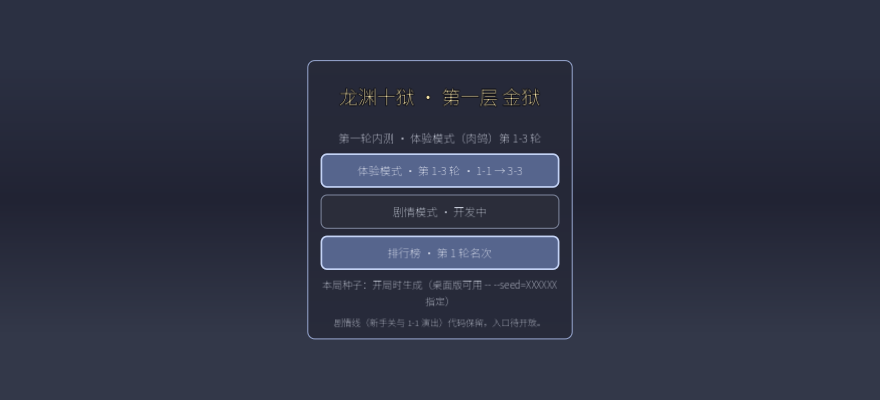
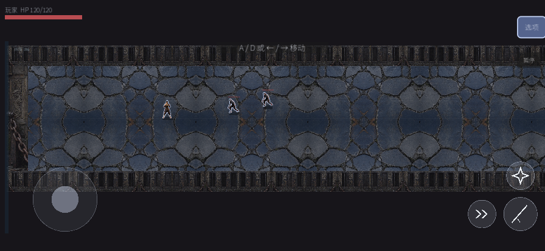
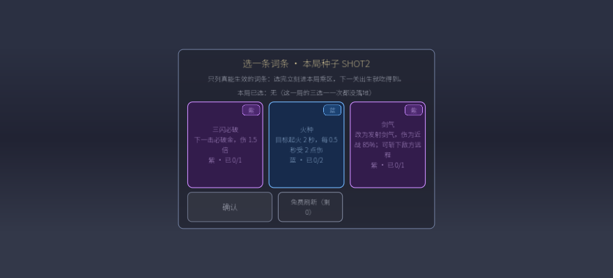

# 龙渊十狱

**在线玩：<https://wangliang-lo.github.io/longyuan-web/>**（手机建议横屏）

2D 横版动作肉鸽。Godot 4.4 导出 Web，手机浏览器或桌面键鼠都能玩。

## 内容

- **三轮九格**：1-1 铁镣廊 → 1-2 桶阵 → 1-3 铁桶汉首领 → 2-1 锁链渡 → 2-2 断墙坊 → 2-3 锁链手首领 → 3-1 金狱廊 → 3-2 金狱堂 → 3-3 金狱深处（金甲狱卒）
- **无尽轮回**：通关 3-3 后继续，轮次越高怪越多、奖分越高
- **首领**：铁桶汉首领（金壳 + 共振破金）、锁链手首领（甩链 + 反制）、金甲狱卒（金壳 200 / 红闪 0.4s / 破壳可抓投处决）
- **动作**：玩家站立 / 走路两帧 / 出招四帧 / 受击 / 闪避 / 拉弓 / 跳跃 / 落地；七种怪物都有起手（蓄力）帧
- **打击感**：刀光、伤害飘字、敌人脚下起手预警环、击杀顿帧与震屏、程序合成音效（无音频文件）
- **词条 17 条**：白 = 纯数值（+6%），蓝 / 紫 = 新机制（击退、闪避 CD、点火、受击位移、破金连锁、格挡、击杀回血、剑气、死缓、三闪必破、三矢、护盾代偿）；三选一按品质着色，紫色第 1 级就能抽
- **局内成长**：三选一词条、升级加点、商店、属性（金防 / 火攻 / 木血 …）

## 操作

| 平台 | 移动 | 普攻 | 重击 | 闪避 | 技能 | 暂停 |
|---|---|---|---|---|---|---|
| 手机 | 左侧摇杆 | 右侧「刀」短按 | 同键长按 | 「»」键 | 有属性后出现 | 右上角「暂停」 |
| 桌面 | WASD / 方向键 | 左键 / J | 右键 / K | Shift / 空格 | O | Esc |

- 手机右上角「选项」可调 **按键大小 / 摇杆大小 / 显示浓度**，设置会记住
- 弓：按下不射、松手判定 —— 短按速射，按住 0.4 秒以上进蓄力（屏幕下方有蓄力条，三档）
- 弓与近战都有瞄准辅助：正下方 / 正上方的敌人也能打到

## 界面说明

- 怪物身上有血条；首领在屏幕上方有带名字的大血条
- 命中会冒伤害数字（轻 / 重 / 破金 / 处决不同颜色）
- 敌人出手前脚下有红色预警环，同时换成蓄力姿势
- 技能键冷却显示一位小数（如 3.2），用七段数码绘制
- 进关会提示本局已持有的词条

## 技术说明

- 本仓库只放构建产物（`index.html` / `index.js` / `index.pck` / `index.wasmz` 等），源码不在此仓库
- 加载器：分段下载（3 路并发）+ 断点续传（Range / Cache Storage），弱网重试并显示速度与预计剩余
- 刷新拿到的一定是新包：资源 URL 带内容指纹（`index.pck?h=…`），新包即新 URL
- 诊断：URL 加 `?dbg=1` 显示加载阶段与帧数（启动后自动收起）；`?par=N` 调下载并发（1~8）
- 排行榜：静态托管无后端 → 显示本机榜；本机服务器在线时切换到全网榜（`/api/board`）
